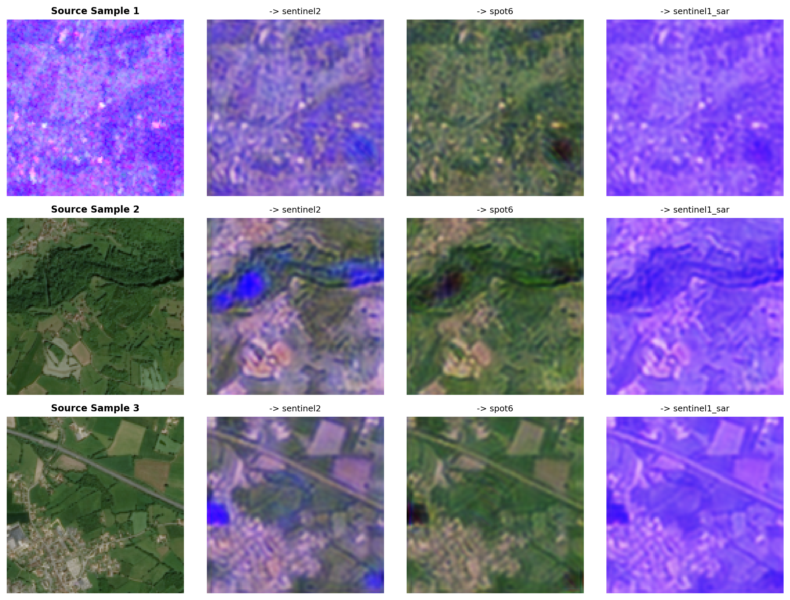
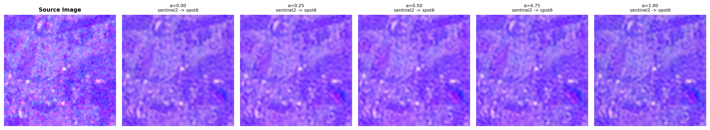

# Self-Supervised Multi-Domain Adaptation for Satellite Imagery

Dissertation Phase I project, M.Tech, CHRIST (Deemed to be University), Bangalore.

**Student:** Shivangi (2567113) · **Guide:** Prof. Benedict Tephila M · **Co-guide:** Dr. Naveen J

> **Scope:** This repository covers **Objectives 1 and 2** of the dissertation. Objectives 3 and 4 are future work. The code for them exists but has not been evaluated, and no results are claimed for them.

## Overview

Satellite AI models are usually trained on one sensor, season, or region and then deployed across many. Performance drops sharply under this *domain shift*, even when the land-cover classes are identical. Standard fixes need labeled target-domain data and a clear domain boundary. Both are expensive, and the boundary is often undefined in blended multi-sensor mosaics.

This project extends **SS(DA)²** (Zhang, Shi & Zhu, 2023), which adapts between two satellites without labels, to **many sensors at once**. It has two parts:

1. **Domain encoder (Objective 1):** learns a continuous, label-free domain embedding directly from unlabeled satellite patches.
2. **Conditional generator (Objective 2):** one AdaIN-based generator translates a patch into the style of any target domain, conditioned on that embedding.

### Research gap

No prior method combines all three of the following for satellite imagery:

- no manual domain labels
- one model for many satellites, not one pair at a time
- a continuous domain code, so any new patch can be embedded rather than only pre-listed domains

## Objectives

| # | Objective | Status |
|---|-----------|--------|
| 1 | Domain encoder that learns continuous domain embeddings from unlabeled multi-sensor patches | Done |
| 2 | Single conditional generator that translates content into the style of an arbitrary target domain | Done |
| 3 | Generalization to sensor pairs never jointly seen in training (leave-one-pair-out, zero-shot) | Future work |
| 4 | Downstream impact: real classification/segmentation accuracy gains | Future work |

## Method

```
Stage 1 (Objective 1): self-supervised domain encoder
  unlabeled patch x -> two augmented views -> domain encoder E -> embeddings z1, z2 -> InfoNCE loss

Stage 2 (Objective 2): one conditional generator (encoder frozen)
  source patch x_src -> content encoder -> content c ---\
                                                         >-> AdaIN residual blocks + decoder G -> translated x^
  target exemplar x_tgt -> domain encoder E -> style z_tgt -/                                          |
                                                                          projection discriminator D + 6-term loss
```

**Stage 1: domain representation learning**
- Accepts multi-spectral, RGB, or SAR input
- Multi-scale features with squeeze-and-excitation (SE) channel attention
- Mean and standard-deviation style statistics
- InfoNCE contrastive loss
- Output is a continuous domain style vector. An optional viewing-angle branch exists but is unused here.

**Stage 2: style-guided translation**
- The content encoder extracts spatial features, and the target style vector drives AdaIN.
- The decoder uses bilinear upsampling. A spectral-norm projection discriminator improves realism.
- Six training losses: adversarial, style, cycle, semantic, edge (Sobel), and identity.
- Loss weights: cycle 10, semantic 2, edge 2, adversarial 1, style 1, identity 1.

## Data

**PASTIS-HD** (used): three co-registered sensors, Sentinel-2 (optical), Sentinel-1 (SAR), and SPOT 6/7 (very-high-resolution optical). It covers 2,433 locations across France, and the first 1,500 patches per sensor were converted.

| Item | Detail |
|------|--------|
| Patch size | 128 × 128 px, 4 channels, scaled to [-1, 1] |
| Channels | S2 = R, G, B, NIR · SPOT = R, G, B + NIR proxy · SAR = VV, VH, ratio, mean |
| Split | By patch ID: 1,200 train / 300 held-out per sensor |

**MSC-France** (Sentinel-2, Landsat-8, SPOT-6 triplets, 4,496 scenes) is supported by the download and conversion scripts but was **not used** in these experiments.

### Known data caveats

- All held-out patches come from a single tile (T31TFM), so the test is a different-region test but not a diverse one.
- The modalities are not simultaneous: Sentinel-1 is about 11 days after Sentinel-2, and SPOT is from 2019.
- The SAR difference channel is saturated (about 98% of values at +1).
- The SPOT fourth channel is a NIR proxy, not a real NIR band.

## Results (300 held-out patches per sensor)

Single short CPU training run (Intel i7-9750H, 7.8 GB RAM, PyTorch). Encoder: AdamW, lr 5e-4, temperature 0.07, 10 epochs, batch 8. Generator and discriminator: Adam, lr 3e-4, 12 epochs, width 32, 4 AdaIN blocks.

### Objective 1: domain encoder

| Metric | Result |
|--------|--------|
| Pretext task, held-out loss | 0.24 (chance 2.08) |
| Sensor identity (nearest centroid) | 65.8% (chance 33.3%) |
| Per-sensor recall | S2 63% · SPOT 74% · SAR 60% |
| Sensor separation | Silhouette 0.11, about 4 effective dimensions: the sensors overlap |
| Cross-sensor scene retrieval | At chance: no cross-sensor scene signal |

### Objective 2: conditional generator

- **Structure preserved.** Edge correlation is 0.71 to 0.94, against 0.61 to 0.70 for real sensor pairs. SPOT to SAR and S2 to SPOT are best. Any-to-Sentinel-2 is weakest, a blurred haze.
- **Fidelity.** Translation beats copying the source on PSNR for all six ordered pairs. However, a constant target-mean image scores higher, so **target radiometry is not reproduced**.
- **Continuous style space.** SAR-target pairs respond smoothly and near-linearly (linearity 0.91 and 0.96, monotone for 96 to 100% of patches). S2 to SPOT saturates after the first step (linearity 0.60, monotone for 41%).
- **Speed.** One generator covers every ordered pair, at about 84 ms per patch on CPU.

### Outputs

Trained checkpoints and figures from this run are in [`outputs_pastis_fixed/`](outputs_pastis_fixed/):

- `domain_encoder.pth`: Objective 1 encoder
- `generator.pth` and `discriminator.pth`: Objective 2 conditional generator and discriminator
- `visualizations/`: figures below





### Limitations

- Sensor identity is only moderately captured (65.8%).
- Translations into Sentinel-2 fail, collapsing to a source-independent color cast.
- Held-out data is one tile, with non-simultaneous modalities and a saturated SAR channel.
- Results come from a single unseeded CPU run, and no baselines from other methods (SS(DA)², StarGAN v2) were run.

## Repository layout

```
main.py                     entry point for all pipeline stages
configs/config.py           configuration and per-dataset overrides
data/                       dataset classes, transforms, download/conversion scripts, synthetic generator
models/                     domain_encoder, generator, discriminator, losses, downstream_task
utils/                      metrics, inference, visualizer
train_domain_encoder.py     Stage 1 training
train_generator.py          Stage 2 training
train_downstream.py         downstream task training (Objective 4, not yet evaluated)
evaluate_generalization.py  unseen-pair evaluation (Objective 3, not yet evaluated)
demo_app.py                 interactive demo
embed_dashboard.py          builds the self-contained visualizer dashboard
tests/                      pytest suite
docs/                       review presentations and literature review
```

## Getting started

**Requirements:** Python 3.10+, PyTorch ≥ 2.4. A GPU is optional, since the reported results were trained on CPU.

```bash
git clone https://github.com/shivangichaudhary/Self-supervised-multi-domain-adaption-in-satellite-imagery.git
cd Self-supervised-multi-domain-adaption-in-satellite-imagery
pip install -r requirements.txt
```

### Data

```bash
# Download PASTIS-HD (use --source zenodo as an alternative to Hugging Face)
python data/download_datasets.py --dataset pastis_hd --source huggingface

# Convert to aligned 128x128 patches
python data/convert_real_datasets.py --max_patches 1500
```

To try the pipeline without real data, use `--dataset synthetic`, which generates a synthetic simulation.

### Run the pipeline

```bash
# Everything: data, encoder, generator, downstream, eval
python main.py --dataset pastis --stage all --device auto

# One stage at a time
python main.py --dataset pastis --stage encoder
python main.py --dataset pastis --stage generator
python main.py --dataset pastis --stage eval
```

`--stage` accepts `all`, `data`, `encoder`, `generator`, `downstream`, or `eval`. `--mode` selects the domain type: `sensor` (default), `angle`, or `both`. `--config path.yaml` applies overrides.

### Tests

```bash
pytest
```

## Future work

- **Objective 3:** leave-one-pair-out and zero-shot (SpaceNet 6) generalization tests.
- **Objective 4:** downstream crop classification and segmentation accuracy gains.
- Better encoder pretext task: sensor-aware positive pairs, pretraining on MSC-France.
- Fix the data issues: tile-stratified split, matched acquisition dates, non-saturating SAR channel.
- Train wider on a GPU with seeds, loss ablations, and baselines (SS(DA)², StarGAN v2).
- Later: optical-SAR adaptation, foundation models (SatMAE, Prithvi), change detection.

## References

1. Zhang, F., Shi, Y., & Zhu, X. X. (2023). *Self-supervised Domain-agnostic Domain Adaptation for Satellite Images.* arXiv:2309.11109.
2. Choi, Y., et al. (2018). *StarGAN: Unified Generative Adversarial Networks for Multi-Domain Image-to-Image Translation.* CVPR 2018.
3. Choi, Y., Uh, Y., Yoo, J., & Ha, J.-W. (2020). *StarGAN v2: Diverse Image Synthesis for Multiple Domains.* CVPR 2020.
4. Tasar, O., et al. (2020). *StandardGAN: Multi-source Domain Adaptation for Semantic Segmentation of Very High Resolution Satellite Images by Data Standardization.* arXiv:2004.06402.
5. Vinholi, J. G., et al. (2024). *Multi-Sensor Diffusion-Driven Optical Image Translation for Large-Scale Applications.* arXiv:2404.11243.
6. Kieu, D., et al. (2025). *Universal Multi-Domain Translation via Diffusion Routers.* arXiv:2510.03252.
7. Sainte Fare Garnot, V., & Landrieu, L. (2021). *Panoptic Segmentation of Satellite Image Time Series with Convolutional Temporal Attention Networks.* ICCV 2021.
8. Astruc, G., et al. (2024). *OmniSat: Self-Supervised Modality Fusion for Earth Observation.* ECCV 2024.
