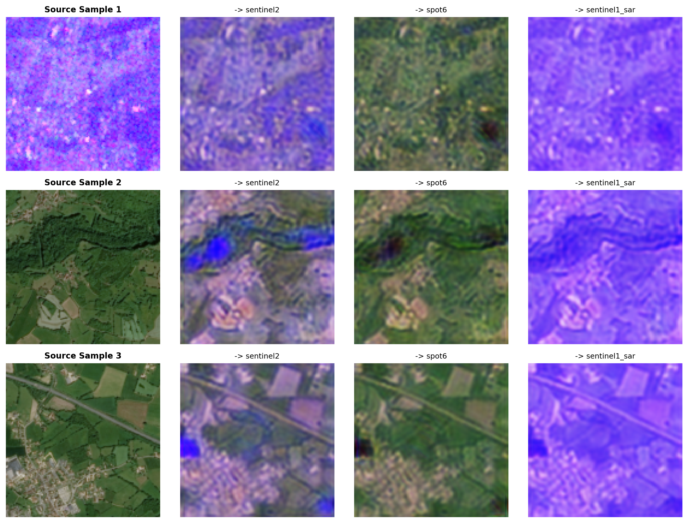
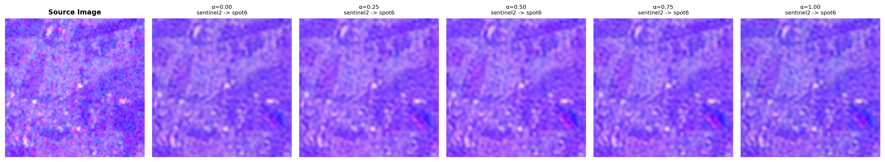

# Self-Supervised Multi-Domain Adaptation for Satellite Imagery

Dissertation Phase I project, M.Tech, CHRIST (Deemed to be University), Bangalore.

**Student:** Shivangi (2567113) · **Guide:** Prof. Benedict Tephila M · **Co-guide:** Dr. Naveen J

> **Scope:** This repository covers **Objectives 1 to 4** of the dissertation. Objectives 1 and 2 (encoder and generator) were evaluated first, in a short CPU run. Objectives 3 and 4 were then evaluated on a GPU with fixed seeds (see [Results](#results-300-held-out-patches-per-sensor)). Their findings are mostly negative or mixed, and they are reported as measured.

## Overview

Full write-up: [Dissertation Phase I report (PDF)](docs/Final_Project_Report.pdf).

Satellite AI models are usually trained on one sensor, season, or region and then deployed across many. Performance drops sharply under this *domain shift*, even when the land-cover classes are identical. Standard fixes need labeled target-domain data and a clear domain boundary. Both are expensive, and the boundary is often undefined in blended multi-sensor mosaics.

This project extends **SS(DA)²** (Zhang, Shi & Zhu, 2023), which adapts between two satellites without labels, to **many sensors at once**. It has two parts:

1. **Domain encoder (Objective 1):** learns a continuous, label-free domain embedding directly from unlabeled satellite patches.
2. **Conditional generator (Objective 2):** one AdaIN-based generator translates a patch into the style of any target domain, conditioned on that embedding.

### Research gap

No prior method combines all three of the following for satellite imagery:

- no manual domain labels
- one model for many satellites, not one pair at a time
- a continuous domain code, so any new patch can be embedded rather than only pre-listed domains

## Objectives

| # | Objective | Status |
|---|-----------|--------|
| 1 | Domain encoder that learns continuous domain embeddings from unlabeled multi-sensor patches | Done |
| 2 | Single conditional generator that translates content into the style of an arbitrary target domain | Done |
| 3 | Generalization to sensor pairs never jointly seen in training (leave-one-pair-out, zero-shot) | Done, see Results |
| 4 | Downstream impact: real classification/segmentation accuracy gains | Done, see Results |

## Method

```
Stage 1 (Objective 1): self-supervised domain encoder
  unlabeled patch x -> two augmented views -> domain encoder E -> embeddings z1, z2 -> InfoNCE loss

Stage 2 (Objective 2): one conditional generator (encoder frozen)
  source patch x_src -> content encoder -> content c ---\
                                                         >-> AdaIN residual blocks + decoder G -> translated x^
  target exemplar x_tgt -> domain encoder E -> style z_tgt -/                                          |
                                                                          projection discriminator D + 6-term loss
```

**Stage 1: domain representation learning**
- Accepts multi-spectral, RGB, or SAR input
- Multi-scale features with squeeze-and-excitation (SE) channel attention
- Mean and standard-deviation style statistics
- InfoNCE contrastive loss
- Output is a continuous domain style vector. An optional viewing-angle branch exists but is unused here.

**Stage 2: style-guided translation**
- The content encoder extracts spatial features, and the target style vector drives AdaIN.
- The decoder uses bilinear upsampling. A spectral-norm projection discriminator improves realism.
- Six training losses: adversarial, style, cycle, semantic, edge (Sobel), and identity.
- Loss weights: cycle 10, semantic 2, edge 2, adversarial 1, style 1, identity 1.

## Data

**PASTIS-HD** (used): three co-registered sensors, Sentinel-2 (optical), Sentinel-1 (SAR), and SPOT 6/7 (very-high-resolution optical). It covers 2,433 locations across France, and the first 1,500 patches per sensor were converted.

| Item | Detail |
|------|--------|
| Patch size | 128 × 128 px, 4 channels, scaled to [-1, 1] |
| Channels | S2 = R, G, B, NIR · SPOT = R, G, B + NIR proxy · SAR = VV, VH, ratio, mean |
| Split | By patch ID: 1,200 train / 300 held-out per sensor |

**MSC-France** (Sentinel-2, Landsat-8, SPOT-6 triplets, 4,496 scenes) is supported by the download and conversion scripts but was **not used** in these experiments.

**Growing-season PASTIS-HD (Objective 4 only).** The converter above takes the first Sentinel-2 and Sentinel-1 acquisition of each patch, which is 24 Sep 2018 (after harvest), when crop classes are barely visible: a U-Net trained on it reaches only about 10% mIoU in-domain. For the segmentation experiments, `data/convert_pastis_season.py` rebuilds Sentinel-2 and Sentinel-1A as the per-pixel median of the acquisitions between 15 May and 15 July 2019 (about 8 Sentinel-2 and 9 Sentinel-1A dates). Patch order, split, SPOT images and masks are unchanged, and the original dataset is untouched. The window was fixed before any adaptation result was seen.

**SpaceNet 6 (Objective 3 zero-shot only).** Rotterdam training tiles with Maxar optical imagery (0.5 m) and Capella X-band SAR. `data/convert_spacenet6.py` cuts them into 2,274 patches of 128 × 128 px with the PASTIS channel conventions (optical R, G, B and an (R+G)/2 NIR proxy; SAR VV, VH, VV−VH and mean in dB). The raw data is not part of this repository.

### Known data caveats

- All held-out patches come from a single tile (T31TFM), so the test is a different-region test but not a diverse one.
- The modalities are not simultaneous: Sentinel-1 is about 11 days after Sentinel-2, and SPOT is from 2019.
- The SAR difference channel is saturated (about 98% of values at +1).
- The SPOT fourth channel is a NIR proxy, not a real NIR band.

## Results (300 held-out patches per sensor)

Objectives 1 and 2 come from a single short CPU training run (Intel i7-9750H, 7.8 GB RAM, PyTorch). Encoder: AdamW, lr 5e-4, temperature 0.07, 10 epochs, batch 8. Generator and discriminator: Adam, lr 3e-4, 12 epochs, width 32, 4 AdaIN blocks.

### Objective 1: domain encoder

| Metric | Result |
|--------|--------|
| Pretext task, held-out loss | 0.24 (chance 2.08) |
| Sensor identity (nearest centroid) | 65.8% (chance 33.3%) |
| Per-sensor recall | S2 63% · SPOT 74% · SAR 60% |
| Sensor separation | Silhouette 0.11, about 4 effective dimensions: the sensors overlap |
| Cross-sensor scene retrieval | At chance: no cross-sensor scene signal |

### Objective 2: conditional generator

- **Structure preserved.** Edge correlation is 0.71 to 0.94, against 0.61 to 0.70 for real sensor pairs. SPOT to SAR and S2 to SPOT are best. Any-to-Sentinel-2 is weakest, a blurred haze.
- **Fidelity.** Translation beats copying the source on PSNR for all six ordered pairs. However, a constant target-mean image scores higher, so **target radiometry is not reproduced**.
- **Continuous style space.** SAR-target pairs respond smoothly and near-linearly (linearity 0.91 and 0.96, monotone for 96 to 100% of patches). S2 to SPOT saturates after the first step (linearity 0.60, monotone for 41%).
- **Speed.** One generator covers every ordered pair, at about 84 ms per patch on CPU.

### Objective 3: generalization to unseen sensor pairs

Objectives 3 and 4 were run on a GTX 1650 (4 GB) with seeds 0 to 2. Full tables and bootstrap intervals: [`results/objective3/summary.md`](results/objective3/summary.md) and [`results/objective4/summary.md`](results/objective4/summary.md).

**Leave-one-pair-out.** For each unordered sensor pair, the generator is retrained with both directions of that pair removed from training (same recipe and seed as a "full" reference generator), then tested on the held-out patches of the removed pair. PSNR in dB against the aligned real target, mean ± std over 3 seeds:

| Direction | Seen in training (full) | Never seen (held out) | Held-out minus full, mean (seeds ≥ 0) | Copy source | Constant target-mean |
|---|---|---|---|---|---|
| S2 → SPOT | 15.81 ± 0.30 | 16.33 ± 0.30 | +0.52 (3/3) | 12.78 | 16.98 |
| SPOT → S2 | 10.70 ± 2.13 | 10.73 ± 0.61 | +0.03 (2/3) | 12.78 | 17.09 |
| S2 → SAR | 6.72 ± 0.35 | 7.05 ± 0.31 | +0.33 (2/3) | 5.69 | 20.35 |
| SAR → S2 | 7.52 ± 0.78 | 8.69 ± 0.73 | +1.17 (2/3) | 5.69 | 17.09 |
| SPOT → SAR | 11.52 ± 1.24 | 11.32 ± 0.40 | −0.21 (2/3) | 7.31 | 20.35 |
| SAR → SPOT | 15.99 ± 0.32 | 15.92 ± 0.25 | −0.07 (1/3) | 7.31 | 16.98 |

- **A pair never seen together is not harder.** Held-out-pair generators are not worse than the full generator. The differences lie within the 1 to 2 dB spread between independently trained generators. Only S2 → SPOT is consistently better (about +0.5 dB in all three seeds).
- **Fidelity is still below a constant image.** A constant target-mean image scores higher PSNR than every translation in all six directions, and higher SSIM in five of six (S2 → SPOT ties). Translation beats copying the source on PSNR in five of six directions (SPOT → S2 is the exception).

**Zero-shot SpaceNet 6.** The generators never saw this data. PSNR in dB on 2,274 patches, canonical target style (the stored style of the nearest PASTIS sensor), the optical sensor standing in for SPOT:

| Direction | Published generator (Objective 2) | Retrained, 3 seeds | Same retrained generators on PASTIS held-out | Copy source | Constant target-mean |
|---|---|---|---|---|---|
| SAR → optical | 15.41 | 15.80 ± 0.07 | 16.18 ± 0.36 | 8.45 | 16.56 |
| Optical → SAR | 17.67 | 12.58 ± 1.39 | 11.63 ± 1.26 | 8.45 | 22.56 |

- **Zero-shot is as good as in-distribution.** SpaceNet 6 scores are close to the scores of the same generators on held-out PASTIS patches, and 3 to 9 dB above copying the source. They stay below the constant target-mean image.
- **Style from unlabeled target patches does not help.** Taking the target style from the encoder embedding of unlabeled SpaceNet 6 patches is worse than the canonical style: by 2.6 to 3.7 dB for the published generator and 1.8 to 7.1 dB for the retrained ones. With it, the retrained generators end only 0.1 to 2.0 dB above copying the source.
- **Run-to-run variation is large.** For optical → SAR, four generators give 11.5 to 17.7 dB. The bootstrap intervals in the summary cover test-patch sampling only, not this variation.
- **Caveats.** SpaceNet 6 is 2 m per pixel against 10 m for PASTIS, its SAR is Capella X-band rather than Sentinel-1 C-band, and the SAR was brought onto the PASTIS dB scale with a two-number percentile fit per polarisation. Absolute SAR comparisons are therefore approximate.

### Objective 4: downstream segmentation

A land-cover U-Net (19 classes plus void) is trained with **Sentinel-2 labels only** on the growing-season data (40 epochs, 3 seeds) and tested on SPOT and SAR patches. Adapted variants use no SPOT or SAR labels. mIoU in %, mean ± std over 3 seeds, 300 held-out patches:

| Variant | SPOT | SAR |
|---|---|---|
| Reference: predict the most frequent training class everywhere | 2.25 | 2.25 |
| Source-only (S2 model, no adaptation) | 2.26 ± 0.00 | 0.74 ± 0.90 |
| Mean/std matching to S2, at test time | 5.08 ± 0.49 | 3.32 ± 0.38 |
| Histogram matching to S2, at test time | 5.09 ± 0.74 | 3.15 ± 0.21 |
| Train on mean/std-matched S2 | 5.69 ± 0.15 | 2.26 ± 0.23 |
| Generator translation to S2, at test time | 1.07 ± 0.87 | 0.78 ± 0.89 |
| Generator translation plus raw input (ensemble) | 1.57 ± 0.81 | 0.75 ± 0.92 |
| Train on generator-translated S2 | 1.78 ± 0.11 | 1.45 ± 0.15 |
| Train on S2 plus generator translations | 3.15 ± 0.08 | 1.82 ± 0.26 |
| DANN + entropy (unlabeled target patches) | 2.45 ± 0.70 | 1.59 ± 0.70 |
| Target-supervised upper bound (target labels) | 15.87 ± 0.20 | 19.87 ± 0.07 |

On Sentinel-2 itself the source-only model reaches 15.75 ± 0.27 mIoU.

- **The generator does not improve segmentation.** Every generator-based variant scores below simple per-channel matching on both sensors, and used at test time it is no better than doing nothing. Mixing generator translations into training lowers Sentinel-2 mIoU from 15.75 to 11.54 ± 0.21.
- **The no-adaptation baseline is a constant predictor.** In seed 0 the Sentinel-2 model predicts a single class for 99.8% (SPOT) and 99.9% (SAR) of the target pixels. On SPOT all three seeds score essentially the same as the most-frequent-class reference, so a gain over "source-only" is a gain over a constant prediction.
- **Large gap remains.** The best adapted variant reaches about 5.7 mIoU on SPOT and 3.3 on SAR, against 15.9 and 19.9 with target labels. DANN + entropy is unstable between seeds (SPOT accuracy 39%, 10% and 14%).
- **Caveats.** One held-out tile, 3 seeds, and bootstrap intervals over patches only. Results use the growing-season composite described under Data, not the first-acquisition data.

### Outputs

Trained checkpoints and figures from this run are in [`outputs_pastis_fixed/`](outputs_pastis_fixed/):

- `domain_encoder.pth`: Objective 1 encoder
- `generator.pth` and `discriminator.pth`: Objective 2 conditional generator and discriminator
- `visualizations/`: figures below





### Limitations

- Sensor identity is only moderately captured (65.8%).
- Translations into Sentinel-2 fail, collapsing to a source-independent color cast.
- Held-out data is one tile, with non-simultaneous modalities and a saturated SAR channel.
- Objectives 1 and 2 come from a single unseeded CPU run, and no baselines from other methods (SS(DA)², StarGAN v2) were run.
- Objective 3: generated images are further from the real target than a constant target-mean image in PSNR, so unseen pairs are handled no worse than seen ones, but neither reproduces target radiometry. Seed-to-seed variation (1 to 5 dB) is larger than most held-out-versus-full differences.
- Objective 4: the generator does not improve segmentation over simple per-channel matching, and all adaptation methods stay far below the target-supervised bound. The no-adaptation baseline collapses to a single class.
- Objectives 3 and 4 use 3 seeds and one held-out tile, and their confidence intervals cover test-patch sampling only. The zero-shot data differs in resolution and SAR band (see Data).

## Repository layout

```
main.py                     entry point for all pipeline stages
configs/config.py           configuration and per-dataset overrides
data/                       dataset classes, transforms, download/conversion scripts, synthetic generator
models/                     domain_encoder, generator, discriminator, losses, downstream_task
utils/                      metrics, inference, visualizer
train_domain_encoder.py     Stage 1 training
train_generator.py          Stage 2 training
train_downstream.py         earlier downstream task script (the reported Objective 4 results use experiments/objective4.py)
evaluate_generalization.py  earlier unseen-pair script (the reported Objective 3 results use experiments/objective3.py)
experiments/                Objective 3 and 4 experiments: objective3.py, zero_shot_sn6.py, objective4.py, obj4_baselines.py, summarize.py, run_queue.py
results/                    Objective 3 and 4 metrics, logs and summary tables
demo_app.py                 interactive demo
embed_dashboard.py          builds the self-contained visualizer dashboard
tests/                      pytest suite
docs/                       Dissertation Phase I report (PDF)
```

## Getting started

**Requirements:** Python 3.10+, PyTorch ≥ 2.4. A GPU is optional: the Objective 1 and 2 results were trained on CPU, and the Objective 3 and 4 results on a 4 GB GPU (a generator takes about 40 to 60 minutes there, a full Objective 4 seed about 2.5 hours).

```bash
git clone https://github.com/shivangichaudhary/Self-supervised-multi-domain-adaption-in-satellite-imagery.git
cd Self-supervised-multi-domain-adaption-in-satellite-imagery
pip install -r requirements.txt
```

### Data

```bash
# Download PASTIS-HD (use --source zenodo as an alternative to Hugging Face)
python data/download_datasets.py --dataset pastis_hd --source huggingface

# Convert to aligned 128x128 patches
python data/convert_real_datasets.py --max_patches 1500
```

To try the pipeline without real data, use `--dataset synthetic`, which generates a synthetic simulation.

### Run the pipeline

```bash
# Everything: data, encoder, generator, downstream, eval
python main.py --dataset pastis --stage all --device auto

# One stage at a time
python main.py --dataset pastis --stage encoder
python main.py --dataset pastis --stage generator
python main.py --dataset pastis --stage eval
```

`--stage` accepts `all`, `data`, `encoder`, `generator`, `downstream`, or `eval`. `--mode` selects the domain type: `sensor` (default), `angle`, or `both`. `--config path.yaml` applies overrides.

### Objectives 3 and 4

```bash
# Objective 4 data: growing-season composite (needs data/PASTIS-HD and the converted data/france_dataset)
python data/convert_pastis_season.py --pastis data/PASTIS-HD --orig data/france_dataset --out data/france_dataset_season

# Objective 3: leave-one-pair-out, generators and fidelity only, 3 seeds
python experiments/objective3.py --seeds 0 1 2 --no_downstream

# Objective 3: zero-shot SpaceNet 6 (convert the Rotterdam tiles first, then evaluate every generator)
python data/convert_spacenet6.py --src <path to the AOI_11_Rotterdam folder>
python experiments/zero_shot_sn6.py --sn6 data/spacenet6_dataset --gens published=outputs_pastis_fixed/generator.pth full_seed0=results/objective3/ckpt/seed0_full/generator.pth full_seed1=results/objective3/ckpt/seed1_full/generator.pth full_seed2=results/objective3/ckpt/seed2_full/generator.pth

# Objective 4: downstream segmentation, then the reference numbers
python experiments/objective4.py --seeds 0 1 2 --epochs 40 --data_dir data/france_dataset_season
python experiments/obj4_baselines.py --data_dir data/france_dataset_season
```

`experiments/run_queue.py` runs these long jobs one after another and resumes finished seeds and generators after an interruption. Do not run a second GPU job at the same time on a 4 GB card. `python experiments/summarize.py` rebuilds the tables from the metrics files.

### Tests

```bash
pytest
```

## Future work

- **Objectives 3 and 4:** make translations reproduce target radiometry (a constant target-mean image still scores higher), and test whether better translations improve segmentation over simple per-channel matching.
- Better encoder pretext task: sensor-aware positive pairs, pretraining on MSC-France.
- Fix the data issues: tile-stratified split, matched acquisition dates, non-saturating SAR channel.
- Retrain Objectives 1 and 2 with seeds and loss ablations, and run baselines (SS(DA)², StarGAN v2).
- Later: optical-SAR adaptation, foundation models (SatMAE, Prithvi), change detection.

## References

1. Zhang, F., Shi, Y., & Zhu, X. X. (2023). *Self-supervised Domain-agnostic Domain Adaptation for Satellite Images.* arXiv:2309.11109.
2. Choi, Y., et al. (2018). *StarGAN: Unified Generative Adversarial Networks for Multi-Domain Image-to-Image Translation.* CVPR 2018.
3. Choi, Y., Uh, Y., Yoo, J., & Ha, J.-W. (2020). *StarGAN v2: Diverse Image Synthesis for Multiple Domains.* CVPR 2020.
4. Tasar, O., et al. (2020). *StandardGAN: Multi-source Domain Adaptation for Semantic Segmentation of Very High Resolution Satellite Images by Data Standardization.* arXiv:2004.06402.
5. Vinholi, J. G., et al. (2024). *Multi-Sensor Diffusion-Driven Optical Image Translation for Large-Scale Applications.* arXiv:2404.11243.
6. Kieu, D., et al. (2025). *Universal Multi-Domain Translation via Diffusion Routers.* arXiv:2510.03252.
7. Sainte Fare Garnot, V., & Landrieu, L. (2021). *Panoptic Segmentation of Satellite Image Time Series with Convolutional Temporal Attention Networks.* ICCV 2021.
8. Astruc, G., et al. (2024). *OmniSat: Self-Supervised Modality Fusion for Earth Observation.* ECCV 2024.
